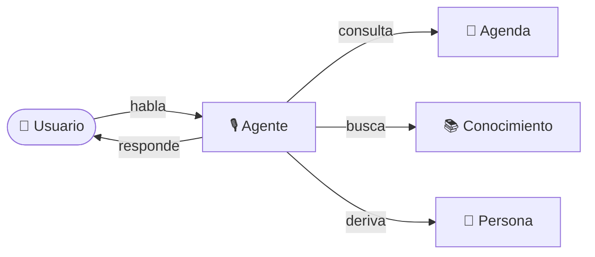

<div align="center">

# 🎙️ Voice Agent

### Un agente de voz en tiempo real que conversa, entiende y resuelve.

**No es un chatbot. Es una conversación.**


</div>

---

<div align="center">

> **La latencia es la feature.**
>
> Un agente que responde en menos de 800 ms y permite interrumpir se siente humano.
> Uno que tarda dos segundos se abandona.

</div>

---

## 📖 Tabla de contenidos

- [La idea en 30 segundos](#-la-idea-en-30-segundos)
- [El problema](#-el-problema)
- [La propuesta](#-la-propuesta)
- [Dos canales, una misma base](#-dos-canales-una-misma-base)
- [Cómo se siente](#-cómo-se-siente)
- [Flujo de una conversación](#-flujo-de-una-conversación)
- [Qué puede hacer](#-qué-puede-hacer)
- [Dos demos](#-dos-demos)
- [Para quién](#-para-quién)
- [Alcance del MVP](#-alcance-del-mvp)
- [Métricas objetivo](#-métricas-objetivo)
- [Modelo de negocio](#-modelo-de-negocio)
- [Fases](#-fases)
- [Documentación](#-documentación)
- [Estado del proyecto](#-estado-del-proyecto)
- [Preguntas abiertas](#-preguntas-abiertas)

---

## ✨ La idea en 30 segundos

Voice Agent atiende conversaciones por voz de principio a fin. Escucha, entiende, responde y **ejecuta acciones reales**: consulta disponibilidad, agenda un turno, responde con el conocimiento del negocio o deriva a una persona.

La misma base sirve para una escuela de idiomas, una clínica, una inmobiliaria o un servicio para el hogar. Cambia la persona del agente, el conocimiento y las acciones que puede ejecutar.

| | |
|---|---|
| **Qué es** | Un agente de voz en tiempo real para atención, agendamiento y práctica conversacional |
| **Para quién** | Negocios que pierden conversaciones y alumnos que necesitan practicar sin depender de un horario |
| **Qué resuelve** | Atención fuera de horario, consultas repetitivas, turnos sin agendar y leads sin respuesta |
| **Cómo se diferencia** | La experiencia en vivo: el comprador habla con el agente y entiende el valor en 30 segundos |
| **Estado** | Idea documentada. Sin código y sin decisiones técnicas |

---

## 🎯 El problema

### Para el usuario final

- **El alumno** quiere practicar speaking, pero depende de un profesor, de un horario y de animarse a hablar con otra persona.
- **El paciente o cliente** llama, cae en un menú telefónico, espera o no lo atienden.
- **El lead** consulta y nadie responde rápido; se enfría y compra en otro lado.
- **El dueño de un servicio** pierde urgencias nocturnas porque no hay quien conteste.

### Para el negocio

- **Costo de atención:** cada conversación consume tiempo humano.
- **Cobertura limitada:** no hay atención fuera de horario ni en picos.
- **Pérdida invisible:** llamadas abandonadas, turnos no agendados, leads sin seguimiento.
- **Herramientas rígidas:** los menús telefónicos no entienden lenguaje natural y los chatbots de texto no se usan.

### Por qué ahora

- Hablar con un asistente de voz ya es cotidiano: el usuario final no necesita aprender nada nuevo.
- La conversación por voz se volvió natural y aceptable en la vida diaria.
- El costo por minuto de una conversación automatizada es competitivo frente a una persona.
- La voz en tiempo real todavía no es un commodity, a diferencia del chatbot de texto.

---

## 💡 La propuesta

Un agente que **escucha, entiende, responde y actúa** por voz en tiempo real.

| Capacidad | Qué significa |
|---|---|
| 🎧 **Escucha natural** | Detecta cuándo el usuario terminó de hablar y responde sin pausas incómodas |
| ⚡ **Respuesta rápida** | Primer audio en menos de 800 ms: la conversación se siente humana |
| ✋ **Interrupciones** | El usuario habla y el agente se detiene en menos de 250 ms |
| 🎭 **Persona configurable** | Nombre, rol, voz, idioma y objetivo se ajustan a cada negocio |
| 🛠️ **Acciones reales** | Consulta disponibilidad, reserva, busca conocimiento y deriva |
| 🧾 **Registro y resumen** | Transcripción, resumen, métricas y costo por sesión |
| 🛡️ **Límites claros** | Duración máxima, presupuesto por sesión y derivación a una persona |

---

## 📱 Dos canales, una misma base

| Canal | Cómo se usa | Cuándo conviene |
|---|---|---|
| 🌐 **Web** | El usuario habla desde el navegador | Demos, práctica de idiomas, atención desde la web del negocio |
| ☎️ **Teléfono** | El usuario llama a un número real | Atención entrante, agenda, urgencias y negocios con volumen de llamadas |

La persona, el conocimiento y las acciones son los mismos. Cambia el canal.

---

## 🎬 Cómo se siente

> **Agente:** "Hi! I'm Alex. We're going to have a short conversation about travel. Ready?"
>
> **Alumno:** "Yes, but I'm a little nervous."
>
> **Agente:** "That's normal. We'll go slow. Tell me about the last trip you took."
>
> **Alumno:** "I go to Bariloche last year with my family."
>
> **Agente:** "Nice! Small correction: 'I went to Bariloche last year.' What did you like most?"
>
> **Alumno:** "Wait, what does 'trip' mean?"
>
> **Agente:** "A trip is a journey, when you travel somewhere. Like your Bariloche trip."

El alumno interrumpe, el agente se detiene, explica y retoma. Al cerrar, recibe un reporte con correcciones, vocabulario nuevo y un puntaje.

---

## 🔄 Flujo de una conversación



1. **El usuario habla.** El agente detecta el turno y escucha.
2. **El agente entiende.** Identifica la intención: preguntar, reservar, practicar o derivar.
3. **Consulta o ejecuta.** Busca disponibilidad, responde con una fuente o agenda.
4. **Confirma.** No inventa datos: valida antes de escribir o prometer algo.
5. **Cierra.** Deja transcript, resumen, acciones y métricas de la sesión.

---

## 🧰 Qué puede hacer

| Caso de uso | Qué hace el agente | Ejemplo |
|---|---|---|
| 🎓 **Tutor de inglés** | Practica conversación por niveles, corrige y reporta progreso | "Practicá 15 minutos y recibí tus errores y vocabulario nuevo" |
| 🏥 **Recepcionista** | Consulta agenda, reserva, reprograma y deriva | "Dame un turno con el doctor Pérez" |
| 🏠 **Calificación de leads** | Pregunta presupuesto, zona y plazo; agenda una visita | "Decime qué buscás y cuándo querés mudarte" |
| 🎧 **Atención nivel 1** | Responde preguntas frecuentes con conocimiento del negocio | "¿Atienden los sábados?" |
| 🍽️ **Reservas** | Consulta disponibilidad, reserva y confirma | "Mesa para cuatro el viernes a las 21" |
| 💼 **Práctica de entrevistas** | Simula una entrevista y da feedback estructurado | "Haceme una entrevista técnica y decime cómo me fue" |

---

## 🎯 Dos demos

| Demo | Qué muestra | Por qué vende |
|---|---|---|
| 🎓 **Tutor de inglés** | Conversación, corrección suave, interrupciones y reporte final | El comprador ve el valor en 2 minutos y entiende que no reemplaza al profesor: lo multiplica |
| 🏥 **Recepcionista** | Consulta de agenda, reserva, confirmación y derivación | El comprador ve una acción concreta sobre su negocio, no una demo genérica |

---

## 🏫 Para quién

| Sector | Dolor | Qué hace el agente | Métrica de valor |
|---|---|---|---|
| 🎓 **Escuelas de idiomas** | Práctica limitada a horarios y profesores | Práctica 24/7, corrección y reporte | Minutos de práctica, retención |
| 🏥 **Clínicas** | Llamadas perdidas, agenda manual, ausentismo | Atiende, agenda, valida y recuerda | Turnos agendados, no-shows |
| 🏠 **Inmobiliarias** | Respuesta lenta a leads | Responde, califica y agenda visita | Leads calificados, visitas |
| 🔧 **Servicios para el hogar** | Urgencias nocturnas sin atención | Toma pedido, prioriza urgencia, agenda | Trabajos capturados |
| 🏋️ **Gimnasios** | Consultas repetitivas y churn | Informa, reserva clase, recupera socio | Retención, reservas |
| 🍽️ **Restaurantes** | Reservas y preguntas frecuentes en hora pico | Reserva y responde | Mesas ocupadas |

**Orden de ataque:**

1. 🎓 **Escuelas de idiomas** — evidencia directa, comprador identificable, demo natural.
2. 🏥 **Clínicas** — dolor medible y presupuesto; cuidado regulatorio.
3. 🏠 **Inmobiliarias** — alto valor por lead y venta rápida.
4. 🔧 **Servicios para el hogar** — retorno directo y ciclo corto.
5. 🏋️ **Gimnasios** — ingreso mensual recurrente y bajo riesgo.

---

## 📦 Alcance del MVP

| ✅ Incluido | ❌ Fuera del MVP |
|---|---|
| Conversación de voz en vivo desde el navegador | Telefonía real (fase 2) |
| Interrupciones: el usuario habla y el agente se detiene | Avatar realista (fase 2, opcional) |
| Persona configurable: nombre, rol, voz, idioma y objetivo | Multiusuario por cliente y facturación |
| Acciones: disponibilidad, reserva, conocimiento y derivación | Integraciones profundas con sistemas del cliente |
| Transcript, resumen y métricas por sesión | Entrenamiento de modelos propios |
| Dos demos: tutor de inglés y recepcionista | Apps móviles |
| Límites de duración y costo por sesión | Análisis de sentimiento avanzado |

> **Principio de alcance:** si una funcionalidad no mejora la conversación, la latencia o la demostración de valor, va para después.

---

## 📊 Métricas objetivo

| Métrica | Definición | Objetivo MVP |
|---|---|---|
| ⚡ **Time to first audio** | Desde que el usuario termina de hablar hasta el primer audio del agente | **p50 < 800 ms** |
| ✋ **Interruption recovery** | Tiempo en detenerse y retomar tras una interrupción | **< 250 ms** para detenerse |
| ✅ **Task completion** | Reserva confirmada o clase completada | **> 80%** |
| 🤝 **Containment** | Conversaciones resueltas sin humano | **> 60%** |
| 💸 **Cost per minute** | Costo variable total | **< USD 0.20** |
| 🎯 **Eval pass rate** | Aserciones aprobadas | **> 85%** |

---

## 💰 Modelo de negocio

> Todos los precios son **hipótesis a validar** con pilotos. No son una promesa.

| Etapa | Qué incluye | Precio hipotético |
|---|---|---|
| 🎁 **Demo** | Link o número con un escenario | Gratis |
| 🧪 **Piloto** | 2 semanas, un escenario, una integración, métricas | USD 500–1.500 |
| 🚀 **Producción** | Número real, agenda o CRM, soporte | Setup USD 1.000–3.000 + USD 300–800/mes + uso |
| ⏱️ **Uso** | Minutos de conversación | USD 0.40–0.80/min |
| 🏷️ **White-label** | Una agencia revende con su marca | USD 500–1.500/mes |

```
Precio por minuto           USD 0.50–0.80
Costo variable por minuto   USD 0.10–0.20
Margen bruto                > 60%
```

---

## 🗺️ Fases

| Fase | Entregable |
|---|---|
| **0. Idea** | Este documento y la documentación del producto |
| **1. Núcleo web** | Conversación, interrupciones, persona, transcript |
| **2. Acciones** | Agenda, conocimiento, derivación, administración |
| **3. Teléfono** | Número entrante, transferencia, métricas |
| **4. Verticales** | Tutor, recepcionista, inmobiliaria, servicios |

---

## 📚 Documentación

| Documento | Qué contiene |
|---|---|
| 📄 [**Idea del proyecto**](docs/idea.md) | La documentación completa: problema, propuesta, evidencia, usuarios, casos de uso, sectores, alcance, métricas, negocio, go-to-market, riesgos y preguntas abiertas |

---

## 🚧 Estado del proyecto

- [x] Idea documentada.
- [x] Producto, alcance y métricas definidos.
- [x] Evidencia de demanda relevada.
- [ ] Validación con potenciales compradores.
- [ ] Decisiones de tecnología, lenguaje y arquitectura.
- [ ] Código.

**La tecnología no está decidida.** Se elige después de leer y validar la idea.

---

## ❓ Preguntas abiertas

1. ¿El beachhead es escuela de idiomas o clínica?
2. ¿El avatar entra en el MVP o en fase 2?
3. ¿El precio por minuto se valida con tres entrevistas antes de publicar la oferta?
4. ¿Se ofrece white-label desde el inicio o después de tres clientes directos?
5. ¿Cuál es la métrica de éxito que el colegio acepta como prueba de valor?

---

<div align="center">

**Voice Agent** · Documentación de producto · 2026

*Hecho para leerse con calma antes de escribir la primera línea de código.*

</div>
